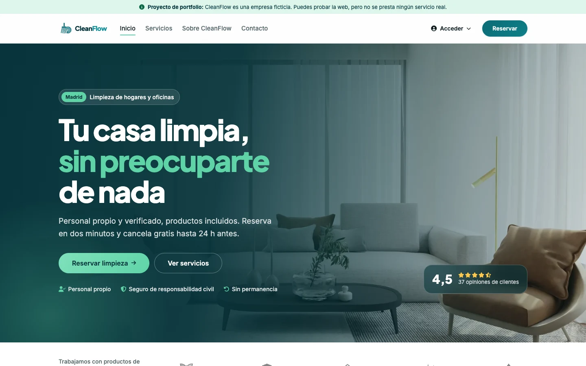
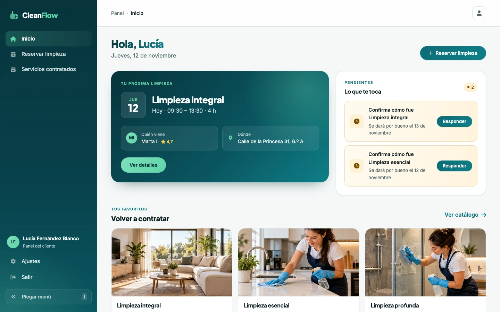
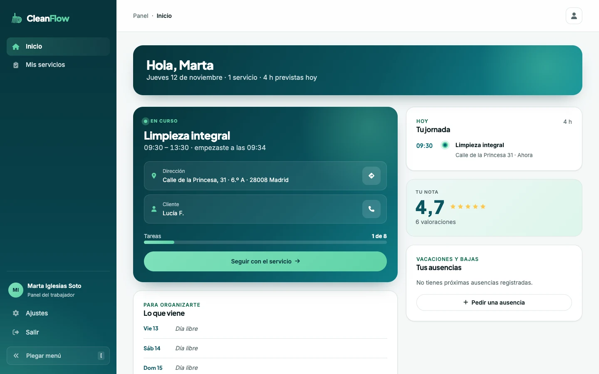
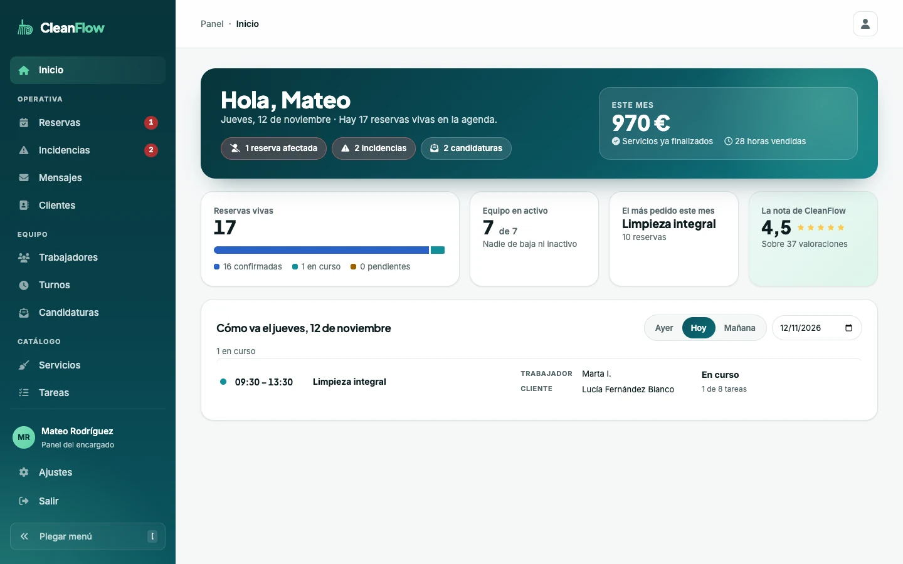
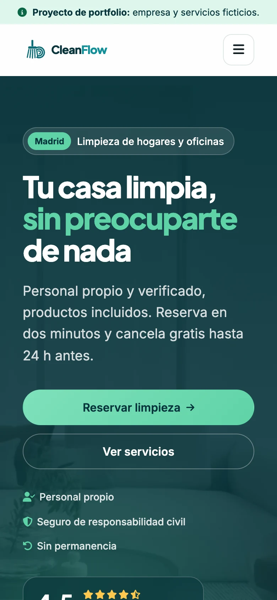
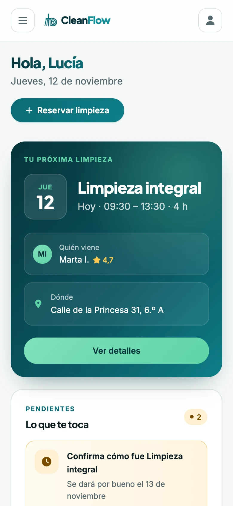
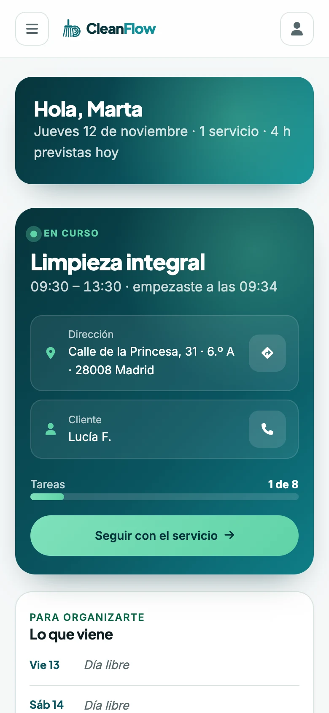
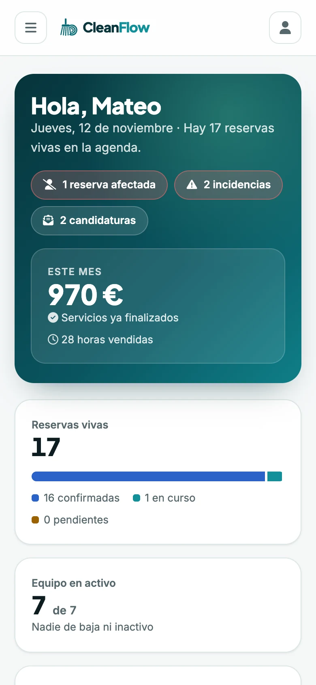

[English](README.md) | **Español**

# CleanFlow

La web de una empresa de limpieza de Madrid, **ficticia**. Tiene su parte pública, donde los clientes ven los servicios y reservan, y tres paneles: el del **cliente**, el del **trabajador** y el del **encargado**. Está hecha con React y Flask, y publicada en Vercel con su base de datos en Neon.

**Web publicada: [cleanflow-lac.vercel.app](https://cleanflow-lac.vercel.app)**



## Qué tiene

- **Web pública:** portada, catálogo de servicios con su precio por hora, «Trabaja con nosotros», contacto y páginas legales.
- **Reservas de verdad:** el cliente elige servicio, fecha y hora entre los huecos libres. La API los calcula con los turnos, las ausencias y las reservas del equipo, y asigna a quien esté libre.
- **Panel del cliente:**
  - su próxima limpieza;
  - sus servicios contratados;
  - confirmar cómo fue y valorarlo;
  - abrir una reclamación con fotos;
  - cancelar hasta 24 h antes;
  - sus direcciones y su cuenta.
- **Panel del trabajador:**
  - su jornada;
  - el servicio en curso, con sus tareas y las fotos del antes y el después;
  - las incidencias;
  - pedir una ausencia.
- **Panel del encargado:**
  - el resumen del día y del mes;
  - las reservas, con las afectadas por una ausencia y las que tienen incidencias;
  - los mensajes, los clientes, el equipo, los turnos y las candidaturas;
  - el catálogo de servicios y tareas.
- **Acceso:** con correo y contraseña, o con Google. Tiene un freno para los intentos fallidos, y cada papel solo ve su panel.
- **Fotos:** la web las reduce antes de subirlas a Cloudinary, para que las del móvil quepan en un envío.

No hay accesos de demostración publicados: para probarla, regístrate como cliente. Los paneles del trabajador y del encargado se ven en las capturas.

## Capturas

**En escritorio**

| Portada | Cliente |
| --- | --- |
|  |  |
| **Trabajador** | **Encargado** |
|  |  |

**En el móvil**

| Portada | Cliente | Trabajador | Encargado |
| --- | --- | --- | --- |
|  |  |  |  |

Las capturas son de los datos de demostración: las personas, las direcciones y las reservas son inventadas.

## Tecnologías

| | |
| --- | --- |
| Web | React 18.3 · React Router 7 · Vite 8 · CSS propio |
| API | Python 3.13 · Flask 3.1 · SQLAlchemy 2 · Flask-Migrate (Alembic) |
| Base de datos | PostgreSQL en [Neon](https://neon.com) |
| Acceso | JWT (Flask-JWT-Extended) · Google Identity Services · bcrypt |
| Fotos | Cloudinary |
| Calidad | ESLint 10 · GitHub Actions |
| Publicación | Vercel: la web en su red y la API como una función de Python en Frankfurt |

## Arrancarlo en local

Hace falta **Python 3.13** con [pipenv](https://pipenv.pypa.io), y **Node 24**.

```bash
pipenv install
npm ci
cp .env.example .env
```

Rellena el `.env`:
- **`FLASK_APP_KEY` y `JWT_SECRET_KEY`** son obligatorias: dos claves distintas de 32 caracteres o más. Para crear una:
  ```bash
  python3 -c "import secrets; print(secrets.token_hex(32))"
  ```
- **`DATABASE_URL`**: tu PostgreSQL. Si la dejas vacía, en local se usa una SQLite temporal.
- **`CLOUDINARY_URL`, `GOOGLE_CLIENT_ID` y `VITE_GOOGLE_CLIENT_ID`** son opcionales. Sin ellas, no se pueden subir fotos y no sale el botón de Google.

Después, crea las tablas y arranca la API y la web, cada una en su terminal:

```bash
pipenv run upgrade   # crea las tablas
pipenv run start     # la API, en http://127.0.0.1:3001
npm run dev          # la web, en http://127.0.0.1:3000
```

| Comando | Qué hace |
| --- | --- |
| `npm run dev` | La web, con recarga en caliente |
| `npm run build` | La versión de producción de la web, en `dist/` |
| `npm run lint` | ESLint, sin permitir ningún aviso |
| `pipenv run start` | La API de Flask |
| `pipenv run upgrade` | Aplica las migraciones a la base de datos |
| `pipenv run migrate` | Crea una migración nueva tras cambiar los modelos |

## Estructura

```
api/index.py         La entrada de la API en Vercel: carga src/app.py
src/app.py           La app de Flask: configuración, base de datos y rutas
src/api/
  models.py          Las tablas
  routes.py          La API: acceso, reservas, paneles, fotos…
  availability.py    Los huecos libres, con turnos, ausencias y reservas
  absence_routes.py  Las ausencias del equipo
src/front/
  pages/             Una carpeta para la web pública y otra para los paneles
  components/        Las piezas: web, paneles y comunes
  services/          Todas las llamadas a la API
  store.js           La sesión y el estado global
  routes.jsx         Las rutas, con las de cada papel protegidas
migrations/          Las migraciones de la base de datos
vercel.json          La web estática, y /api redirigida a la función de Python
```

## Cómo se trabaja

- **`main`** es producción y **`develop`** es donde se juntan los cambios. Cada tarea es una issue del tablero de GitHub Projects, con su rama y su PR a `develop`.
- **Cada PR** pasa el lint, el build y el arranque de la API en GitHub Actions. Vercel crea una copia de prueba, con su propia base de datos.
- **Al fusionar en `main`**, se publica en producción.

## Créditos

- Proyecto final del bootcamp Full Stack de [4Geeks Academy](https://4geeks.com), hecho en equipo con [anyu14](https://github.com/anyu14) y [franciscofortes029-byte](https://github.com/franciscofortes029-byte).
- Rediseño, arreglos y publicación: [Mateo Rodríguez](https://mateorodriguez.solutions).
- Letras: [Inter](https://rsms.me/inter/) y [Plus Jakarta Sans](https://fonts.google.com/specimen/Plus+Jakarta+Sans). Iconos: [Font Awesome](https://fontawesome.com).
- CleanFlow es una empresa inventada: no presta ningún servicio real.

## Licencia

Por ahora, este repositorio no tiene licencia.
