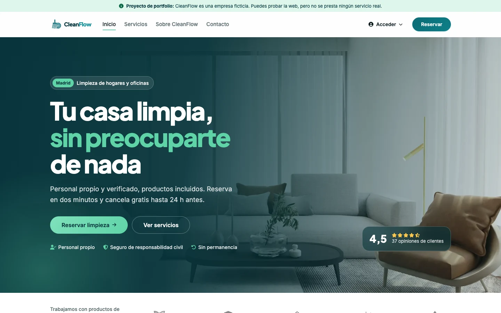
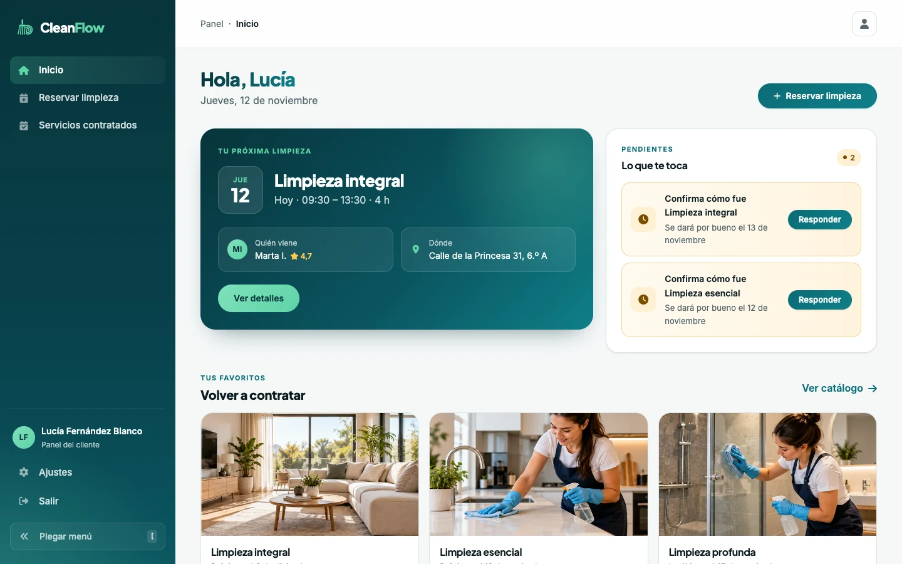
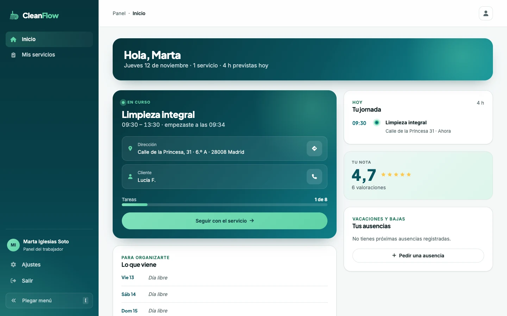
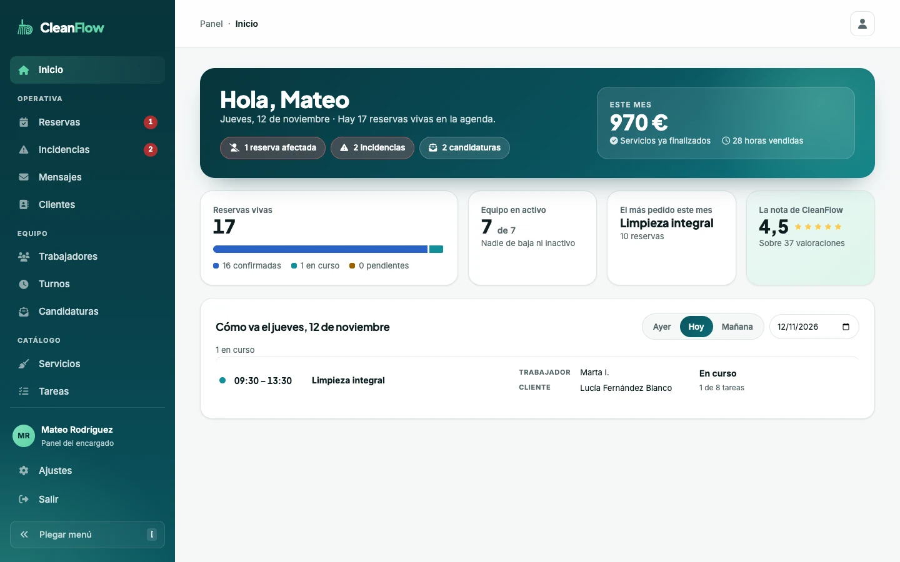
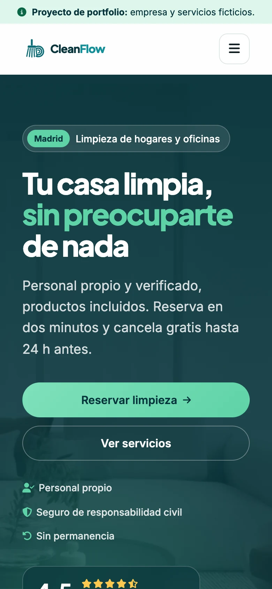
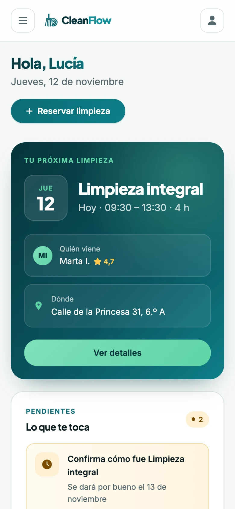
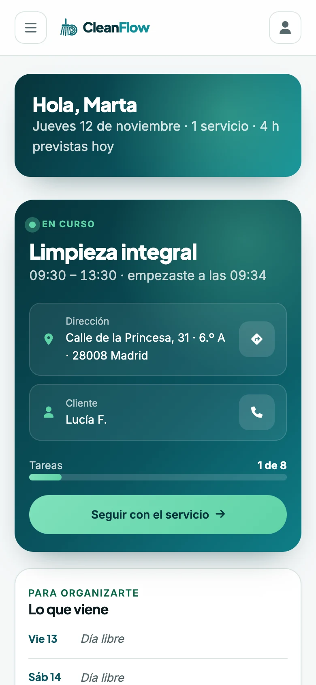
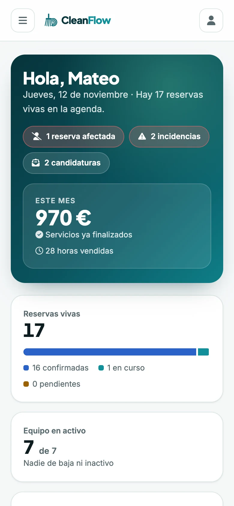

**English** | [Español](README.es.md)

# CleanFlow

The website of a **fictional** cleaning company in Madrid. It has a public side, where clients browse the services and book, and three dashboards: one for the **client**, one for the **worker** and one for the **manager**. It is built with React and Flask, and published on Vercel with its database on Neon.

**Live site: [cleanflow-lac.vercel.app](https://cleanflow-lac.vercel.app)**



## Features

- **Public website:** home page, service catalog with hourly prices, "Work with us", contact and legal pages.
- **Real bookings:** the client picks a service, a date and a time among the free slots. The API works them out from the team's shifts, absences and bookings, and assigns whoever is free.
- **Client dashboard:**
  - their next cleaning;
  - their booked services;
  - confirming how it went and rating it;
  - opening a complaint with photos;
  - cancelling up to 24 h before;
  - their addresses and account.
- **Worker dashboard:**
  - their working day;
  - the service in progress, with its tasks and before-and-after photos;
  - incidents;
  - requesting time off.
- **Manager dashboard:**
  - a summary of the day and the month;
  - bookings, including the ones affected by an absence and the ones with incidents;
  - messages, clients, the team, shifts and job applications;
  - the catalog of services and tasks.
- **Sign-in:** with email and password, or with Google. Failed attempts are rate-limited, and each role only sees its own dashboard.
- **Photos:** the website shrinks them before uploading them to Cloudinary, so phone photos fit in one request.

There are no public demo logins: to try it, sign up as a client. The worker and manager dashboards are shown in the screenshots.

## Screenshots

**On desktop**

| Home | Client |
| --- | --- |
|  |  |
| **Worker** | **Manager** |
|  |  |

**On mobile**

| Home | Client | Worker | Manager |
| --- | --- | --- | --- |
|  |  |  |  |

The screenshots use the demo data: the people, addresses and bookings are made up. The interface is in Spanish.

## Tech stack

| | |
| --- | --- |
| Website | React 18.3 · React Router 7 · Vite 8 · our own CSS |
| API | Python 3.13 · Flask 3.1 · SQLAlchemy 2 · Flask-Migrate (Alembic) |
| Database | PostgreSQL on [Neon](https://neon.com) |
| Sign-in | JWT (Flask-JWT-Extended) · Google Identity Services · bcrypt |
| Photos | Cloudinary |
| Quality | ESLint 10 · GitHub Actions |
| Hosting | Vercel: the website on its network and the API as a Python function in Frankfurt |

## Running it locally

You need **Python 3.13** with [pipenv](https://pipenv.pypa.io), and **Node 24**.

```bash
pipenv install
npm ci
cp .env.example .env
```

Fill in the `.env`:
- **`FLASK_APP_KEY` and `JWT_SECRET_KEY`** are required: two different keys of 32 characters or more. To create one:
  ```bash
  python3 -c "import secrets; print(secrets.token_hex(32))"
  ```
- **`DATABASE_URL`**: your PostgreSQL. If you leave it empty, a temporary SQLite database is used locally.
- **`CLOUDINARY_URL`, `GOOGLE_CLIENT_ID` and `VITE_GOOGLE_CLIENT_ID`** are optional. Without them, photos can't be uploaded and the Google button doesn't show.

Then create the tables and start the API and the website, each in its own terminal:

```bash
pipenv run upgrade   # creates the tables
pipenv run start     # the API, at http://127.0.0.1:3001
npm run dev          # the website, at http://127.0.0.1:3000
```

| Command | What it does |
| --- | --- |
| `npm run dev` | The website, with hot reload |
| `npm run build` | The production build of the website, in `dist/` |
| `npm run lint` | ESLint, with zero warnings allowed |
| `pipenv run start` | The Flask API |
| `pipenv run upgrade` | Applies the migrations to the database |
| `pipenv run migrate` | Creates a new migration after changing the models |

## Project structure

```
api/index.py         The API entry point on Vercel: loads src/app.py
src/app.py           The Flask app: configuration, database and routes
src/api/
  models.py          The tables
  routes.py          The API: sign-in, bookings, dashboards, photos…
  availability.py    Free slots, from shifts, absences and bookings
  absence_routes.py  The team's absences
src/front/
  pages/             One folder for the public website and one for the dashboards
  components/        The building blocks: website, dashboards and shared
  services/          Every call to the API
  store.js           The session and the global state
  routes.jsx         The routes, with each role's routes protected
migrations/          The database migrations
vercel.json          The static website, and /api routed to the Python function
```

## How we work

- **`main`** is production and **`develop`** is where changes come together. Each task is an issue on the GitHub Projects board, with its own branch and a PR to `develop`.
- **Every PR** runs lint, the build and an API start-up check on GitHub Actions. Vercel creates a preview with its own database.
- **Merging into `main`** publishes to production.

## Credits

- Final project of the [4Geeks Academy](https://4geeks.com) Full Stack bootcamp, built as a team with [anyu14](https://github.com/anyu14) and [franciscofortes029-byte](https://github.com/franciscofortes029-byte).
- Redesign, fixes and deployment: [Mateo Rodríguez](https://mateorodriguez.solutions).
- Fonts: [Inter](https://rsms.me/inter/) and [Plus Jakarta Sans](https://fonts.google.com/specimen/Plus+Jakarta+Sans). Icons: [Font Awesome](https://fontawesome.com).
- CleanFlow is a made-up company: it doesn't provide any real service.

## License

This repository has no license for now.
